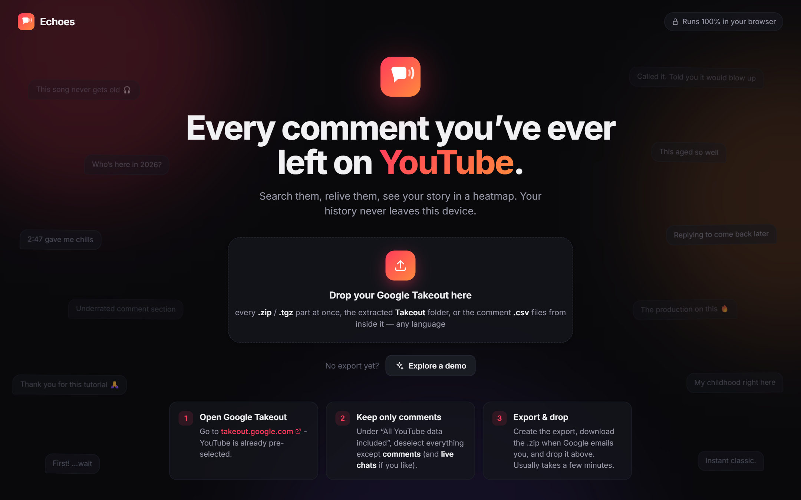
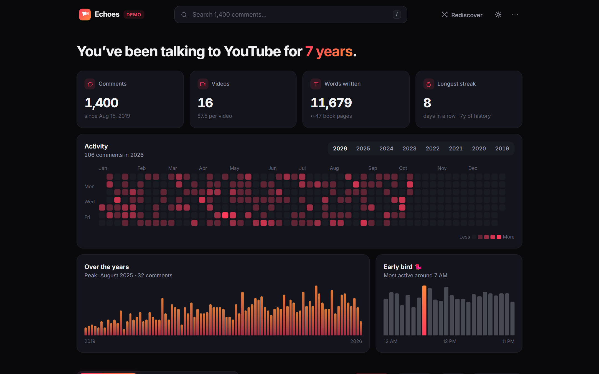
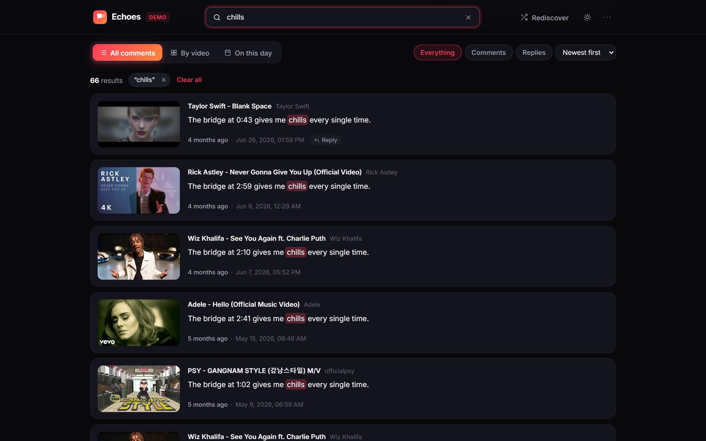
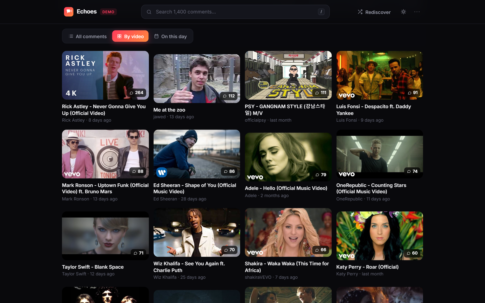
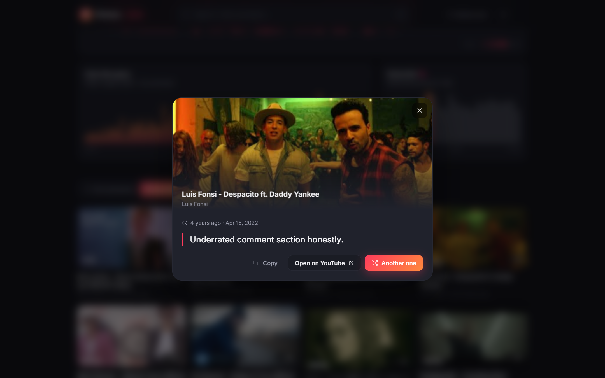
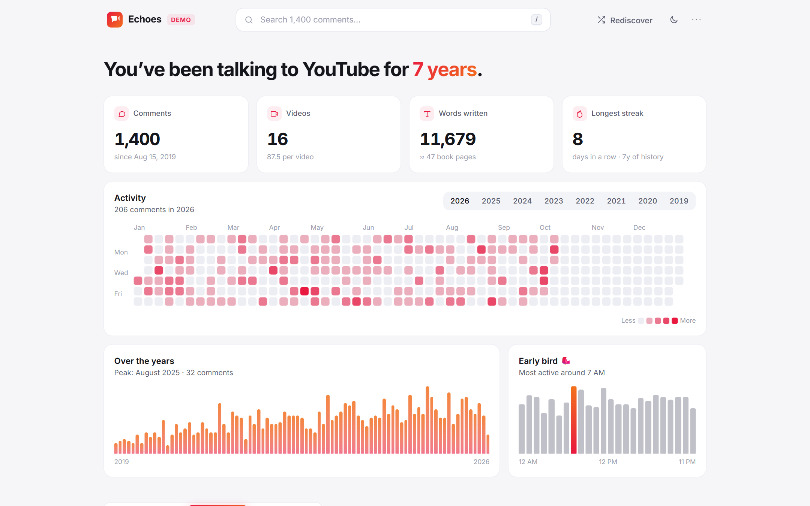

<div align="center">


# Echoes

**Every comment you've ever left on YouTube. Searchable, private, and nice to look at.**

### [**→ Open Echoes**](https://shalashanka.github.io/Echoes/)

<sub>No install, no account, no server. Your history never leaves your device.</sub>

<br />

<a href="https://shalashanka.github.io/Echoes/"></a>

</div>

---

## What it does

Echoes reads your **Google Takeout** export right in the browser and turns years of scattered
comments into something you can actually explore.



- **Your story at a glance:** total comments, videos and words, your longest streak, a GitHub-style
  activity heatmap for every year, a monthly timeline and the hour you comment most. Click a day or
  a month to filter.
- **Instant search** across comment text and video titles, with highlighted matches.
- **Three views:** every comment (virtualized, so tens of thousands scroll smoothly), grouped
  **by video**, and **On this day** for what you wrote on today's date in past years.
- **Rediscover** (`R`) pulls a random comment into a spotlight card.
- **Deep links:** *Open* jumps straight to your comment on YouTube.
- **Export** any filtered selection as CSV or JSON.
- **Dark and light themes**, fully keyboard-driven.

<table>
  <tr>
    <td width="50%"><p align="center"><sub><b>Search</b>: every match, highlighted</sub></p></td>
    <td width="50%"><p align="center"><sub><b>By video</b>: where you talk the most</sub></p></td>
  </tr>
  <tr>
    <td width="50%"><p align="center"><sub><b>Rediscover</b>: a random blast from the past</sub></p></td>
    <td width="50%"><p align="center"><sub><b>Light theme</b>: press <code>T</code></sub></p></td>
  </tr>
</table>

## Get your comments in 3 steps

1. Open **[Google Takeout for YouTube](https://takeout.google.com/settings/takeout/custom/youtube)**.
2. Under *All YouTube data included*, keep only **comments** (and **live chats** if you like).
3. Create the export, download it when Google emails you, and drop it on
   **[Echoes](https://shalashanka.github.io/Echoes/)**.

No export yet? Click **Explore a demo** to try it with sample data.

### Whatever Takeout gives you, just drop it

- **Any language.** Takeout translates every file, folder and column name (`comments.csv`,
  `commenti(3).csv`, `Kommentare.csv`…). Echoes recognises the files by their contents, so the
  export language doesn't matter.
- **Any shape.** Large histories get split into many CSVs, and big exports into several `.zip`
  parts. Drop all the parts at once. `.tgz` exports, an extracted `Takeout` folder, or the loose
  `.csv` / `.html` files work too.
- **Any size.** Archives are read piece by piece, so a multi-gigabyte export with videos inside
  doesn't need to fit in memory. Only the comment files are opened.
- **Old and new formats:** the CSV exports since 2023 and the older `my-comments.html`.

If some numbered parts look missing (say `comments(5).csv`), Echoes tells you, so you can add the
other `.zip` files from the same export.

## Private by design

Everything happens in your browser tab. Your export is never uploaded, and there's no backend,
account, analytics or tracking. The parsed history is kept in your browser's IndexedDB so it opens
instantly next time, and **⋯ → Forget my data** wipes it.

The only network requests are for video thumbnails and titles. Titles come from YouTube's public
oEmbed endpoint, with no API key, and are cached locally.

<details>
<summary><b>Why Takeout and not the YouTube API?</b></summary>
<br />

The YouTube Data API can't list the comments *you* wrote on other people's videos: `commentThreads`
only returns comments posted *on your channel*. Google Takeout is the only official source with your
complete comment history, including replies and live chat.

</details>

## Keyboard shortcuts

| Key | Action |
| --- | --- |
| `/` | Search |
| `Esc` | Clear search / close |
| `1` `2` `3` | All comments / By video / On this day |
| `R` | Rediscover a random comment |
| `T` | Toggle dark / light theme |

## Run it locally

```bash
npm install
npm run dev        # http://localhost:5173
npm run build      # static site in dist/, host it anywhere
```

Every push to `main` is built and published to GitHub Pages by
[`.github/workflows/deploy.yml`](.github/workflows/deploy.yml).

Built with React, TypeScript, Vite, Motion, TanStack Virtual and fflate.
